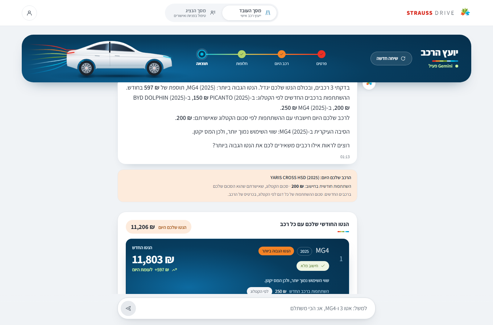
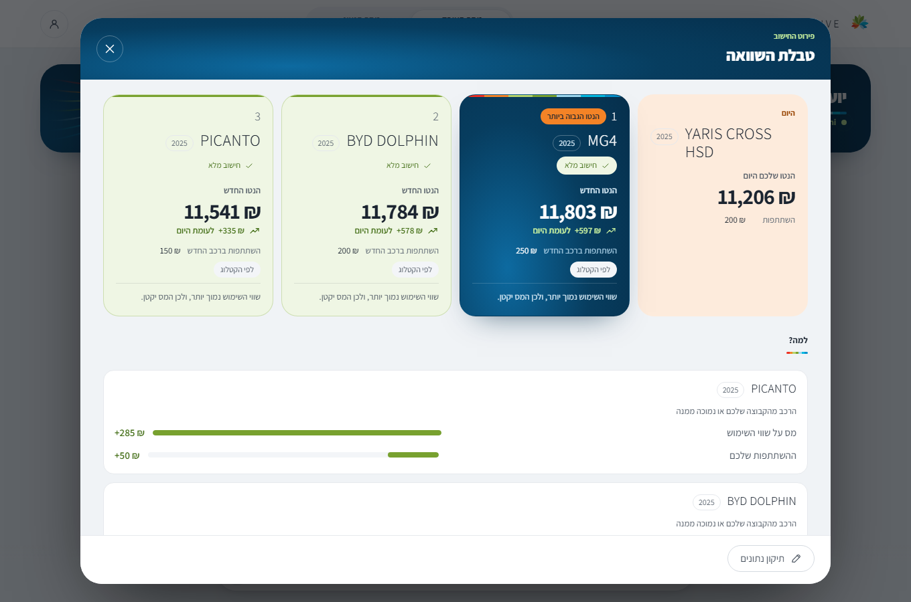
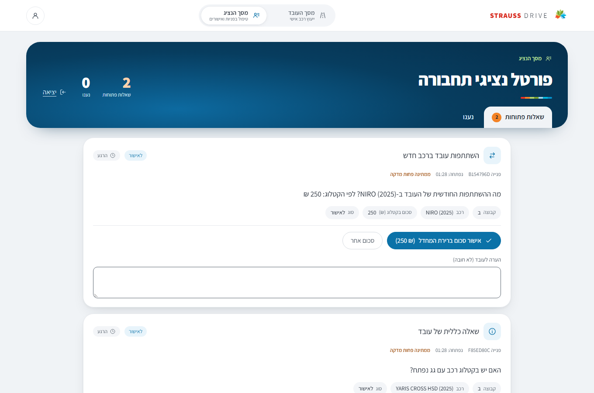
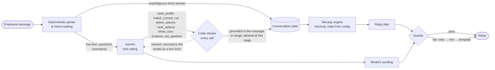
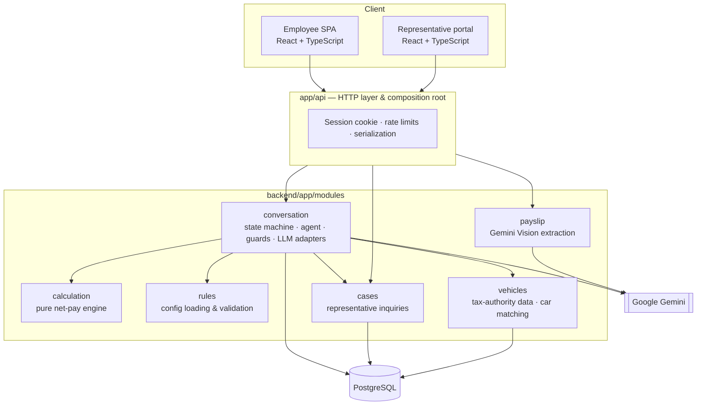
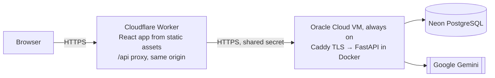

<div align="center">

# STRAUSS DRIVE | AI-Powered Corporate Car Advisor

### 🚀 Live Demo — STRAUSS DRIVE

**[https://strauss-drive.strauss-drive-edge.workers.dev/employee](https://strauss-drive.strauss-drive-edge.workers.dev/employee)**

**Open Code AI Hackathon 2026 | Strauss Challenge — One of the Winning Projects**

A Hebrew conversational advisor that shows an employee, in shekels, how changing their company car changes their monthly net pay.

[](https://strauss-drive.strauss-drive-edge.workers.dev/employee)
[](https://github.com/zehavi-rozental/strauss-car-advisor)
[](https://strauss-drive.strauss-drive-edge.workers.dev/rep)

<br>

<a href="https://strauss-drive.strauss-drive-edge.workers.dev/employee">
  
</a>

<sub>The live product (synthetic data): the advisor's answer in Hebrew, today's car and the monthly net pay with each alternative.</sub>

<br><br>

[](https://github.com/zehavi-rozental/strauss-car-advisor/actions/workflows/ci.yml?query=branch%3Adeploy%2Frender-demo)


</div>

---

## Table of Contents

- [Overview & Business Problem](#overview--business-problem)
- [Solution & Key Features](#solution--key-features)
- [Live Demo](#live-demo)
- [Product Walkthrough](#product-walkthrough)
- [AI Architecture & Conversation Engine](#ai-architecture--conversation-engine)
- [Technology Stack](#technology-stack)
- [System Architecture](#system-architecture)
- [Financial Calculation Engine](#financial-calculation-engine)
- [Payslip Processing](#payslip-processing)
- [Transport Representative Workflow](#transport-representative-workflow)
- [Security & Privacy](#security--privacy)
- [Automated Testing & CI](#automated-testing--ci)
- [Deployment](#deployment)
- [Local Development](#local-development)
- [Project Structure](#project-structure)
- [Hackathon Recognition](#hackathon-recognition)

---

## Overview & Business Problem

An employee who is thinking about switching company cars, moving to an electric car, or giving up the company car altogether rarely knows what that decision will do to their **net** salary. The answer depends on the taxable use value of each car, the employee's tax brackets and credit points, pension and study-fund contributions, the copay the company charges, the eligibility group, electric-car refunds and family-track rules. Today that answer usually means a round of emails with payroll and the transport team.

**STRAUSS DRIVE** turns that into a conversation. The employee describes their situation in plain Hebrew, in any order and in their own words. The advisor collects what it needs, identifies today's car, shows the cars the employee is eligible for, and calculates the monthly net pay for each alternative with a deterministic engine that reproduces Strauss's reference figures. Anything only a person can answer goes to a transport representative, and the answer comes back into the same conversation.

## Solution & Key Features

| | |
| --- | --- |
| **Natural conversation in Hebrew** | Free text, short answers, corrections, questions in the middle of the flow, small talk and "I don't know" are all understood; values can come one at a time or all at once. |
| **Exact net-pay comparison** | Today's net vs. the net with each alternative, the monthly difference and the main reason for it, from a deterministic engine (never from the language model). |
| **"All my options" map** | Every car the employee is eligible for, calculated and sorted by estimated net, with filters, status chips and excluded cars with their reasons. |
| **Payslip upload** | Gemini Vision reads a payslip into a reviewable form; the employee confirms each field before anything is saved. |
| **Transport representative channel** | Questions the data cannot answer (a new car's copay, an eligibility conflict, an arrangement question) become inquiries in a protected representative portal; the answer is applied back into the employee's calculation. |
| **No invented numbers** | A missing amount is never replaced by a default, and every number in a reply must come from the engine, the employee's profile, the catalog or the knowledge base. |
| **Rules as data** | Tax brackets, budgets, the car catalog, occupations and FAQ answers are loaded from configuration files; new rules need no code changes. |

## Live Demo

| | |
| --- | --- |
| Employee advisor | https://strauss-drive.strauss-drive-edge.workers.dev/employee |
| Representative portal | https://strauss-drive.strauss-drive-edge.workers.dev/rep — protected by an access code; demo access is available on request |
| Health endpoint | https://strauss-drive.strauss-drive-edge.workers.dev/api/health |

> The interface is served from Cloudflare's edge and opens instantly; the API runs on an always-on server (no cold start), so the first answer arrives as fast as the next one. Measured through the public link: page in ~0.1 s, answers computed by code in ~0.2 s, answers written with Gemini in ~2–3 s. The interface is in Hebrew (right-to-left), and the demo uses synthetic data.

## Product Walkthrough

All screenshots use synthetic data.

**1. Conversation and comparison** (the screenshot at the top). The advisor answers in plain Hebrew, names the car with the highest net, the catalog copays and the main reason, and shows each alternative as a card with its new net and the monthly change.

**2. Calculation breakdown.** Today's car next to every alternative, with the factors behind each difference (tax on the use value, copay).



**3. Transport representative portal.** A new car's copay waiting for one-click approval of the catalog amount, and a general question the knowledge base could not answer. The representative sees only the context it needs (group, car, catalog amount) — never the employee's salary.



## AI Architecture & Conversation Engine

The core design decision: **the language model understands the employee; code decides, validates and calculates.** Gemini never computes a figure and never changes data without code checking it.



**Hybrid routing.** A short answer that the deterministic parser reads in full ("18000", "קבוצה ב", "לא מופרש") is saved by code and answered by a template, with no model call. Everything else — free wording, questions, corrections, uncertainty — goes to Gemini with the active question, the recent history, the confirmed data and the full catalog and FAQ in the prompt. When code has already read the whole message, the model only phrases the reply and receives no tools.

**Tool calling with code guardrails.** Gemini acts through six tools. Every call passes code checks before it touches the state:
- **Grounding** — a value is saved only if the employee actually said it (digits or Hebrew number words; a zero needs an explicit "none" next to its field, or a short "no" to the question on screen).
- **Field binding** — a bare answer ("6%", "גם לא") belongs to the one field the last question asked, never remapped to another.
- **Ranges and unusual values** — out-of-range values are refused; rare ones (0% pension, 0 credit points, an amount that may be missing "thousands") are held and confirmed once.
- **Role checks** — a car said as "today's car" is never selected as an alternative, and vice versa.

**Answer verification.** Every model reply passes guards before it is shown: each number must appear in the state, a tool result, the FAQ or the employee's message; every policy sentence carries a hidden source tag (`[[faq:…]]`, `[[state]]`, `[[catalog]]`); a second, budgeted Gemini call verifies claims against the FAQ and state; shape rules keep one question per reply, in a consistent form of address. A failing reply is retried once, then trimmed to its supported sentences, then replaced by a template.

**State and context.** A code-driven state machine owns the conversation: what is known, missing, unknown, held for confirmation or deferred. Values are saved only when stated or confirmed; a missing amount is never a default; every saved value is acknowledged ("רשמתי: …"); corrections at any stage trigger a recalculation.

**Fallbacks.** An `LLM_CHAIN` (Gemini Flash-Lite, then Gemini Flash) with cooldowns and a per-turn deadline; when no model is available, the whole conversation still works in template mode, and the UI shows which engine is answering.

## Technology Stack

| Layer | Technologies |
| --- | --- |
| Backend | Python 3.11+, FastAPI, Pydantic v2, SQLAlchemy 2, Alembic |
| AI | Google Gemini API (`gemini-3.5-flash-lite`, fallback `gemini-3.6-flash`): tool calling, structured output, vision |
| Frontend | React 19, TypeScript, Vite |
| Data | PostgreSQL on Neon (production, Frankfurt), SQLite (local and tests); tax-authority use-value file, Strauss rules JSON and data workbook |
| Testing | Pytest, Hypothesis, Vitest, Playwright, import-linter |
| Delivery | Cloudflare Workers (edge: static React app + API proxy), Oracle Cloud Always Free (Docker Compose, Caddy HTTPS), Neon PostgreSQL, GitHub Actions |
| Email | SMTP backend with encrypted addresses and an outbox worker (tested end to end with Resend as the SMTP provider; disabled in production) |

## System Architecture

A **modular monolith** in a ports-and-adapters style. Each module exposes a single `public.py`; [import-linter](https://github.com/seddonym/import-linter) contracts enforce the boundaries in CI, so any module can later be extracted into a service.



- `calculation` imports nothing from the database, FastAPI or other modules (enforced).
- `cases` never imports `conversation`; answers travel as `QuestionAnswered` events that the conversation applies idempotently.
- Employee screens receive representative answers by polling `GET /api/conversations/{id}/updates?after=<seq>`.

### Production topology



- **Instant first load:** the React build is served by a Cloudflare Worker from static assets; only `/api/*` runs Worker code, which passes the request to the backend on the same origin (so the session cookie stays first-party and no CORS is needed).
- **Always-on API:** the FastAPI container runs on an Oracle Cloud Always Free VM behind Caddy (automatic Let's Encrypt certificates). Docker restarts it if it crashes, and a health check restarts it if it stops answering.
- **Readiness in the client:** one health probe with a timeout and backoff opens the chat only when the server and its database answer, and tells a starting server apart from a real rate limit.
- **Managed database:** Neon PostgreSQL (Frankfurt, next to the VM); pooled connections are checked before use, since a serverless database closes idle connections.

## Financial Calculation Engine

- **Money is `Decimal` only.** No floats; rounding happens once, for display.
- **Rules from configuration:** tax brackets, credit-point value, pension credit, National Insurance and health thresholds, group budgets, electric-car handling and the family track come from `strauss-rules.json`, the Strauss data workbook and `extensions.yaml`. Supported policy alternatives can be switched in the rules file alone; anything else fails loading with a clear error.
- **Reference results:** the engine reproduces **12 of 12** net-pay figures in Strauss's reference data (`python -m app.verify`).
- **Independent oracle:** `tests/reference_oracle.py` re-implements the net method from the rules file without any engine code; tests pin the reference sheet to the oracle and the engine to the oracle, component by component, to the agora.
- **Tax-authority data:** the 2026 use-value file (77,988 rows) is imported transactionally; the current car is matched against the company catalog first, then the tax file.

The full calculation method is described step by step in the [Hebrew documentation](docs/README.he.md#איך-מחושב-הנטו).

## Payslip Processing

- The employee uploads a PDF or image; the file is validated (type sniffing, size, page count, encrypted PDFs refused) and sent inline to Gemini Vision. **It is never written to disk or stored.**
- The model answers under a fixed response schema; code sorts the items into the seven profile fields and informational items (gross, net, taxes, unclassified additions), each with the reason it is not entered.
- Nothing is converted or guessed: an amount never becomes a percentage, an addition never becomes a bonus, and the payslip's own net is never used.
- Six explicit outcomes (found, partial, nothing found, not a payslip, unreadable, failed) and a review screen where every row is an explicit choice: keep the conversation's value, take the payslip's, or type another.

## Transport Representative Workflow

1. The conversation detects what only a person can answer: a new car's copay before approval, a car with no catalog copay, an occupation/group conflict, or an arrangement question the knowledge base does not cover.
2. Only deterministic code opens an inquiry (the model can only offer one); the employee sees exactly what will be sent before it is sent.
3. The representative works in a protected portal (`/rep`): open and answered tabs, one-click approval of a catalog amount, or another amount with a note.
4. The answer appears in the employee's conversation; a copay answer is offered as an update and recalculates every result once the employee confirms it.
5. Optional email notice: the address is encrypted, verified with a one-time link, and the email is a notice only — the conversation remains the record.

## Security & Privacy

Implemented and covered by tests; not a certified or audited security program.

| Area | Implementation |
| --- | --- |
| Employee sessions | Conversation access by an `HttpOnly`, `SameSite=Lax` session cookie (`Secure` configurable); only a hash of the token is stored and it is compared in constant time. |
| Representative access | Access code in the `X-Rep-Token` header, compared with `hmac.compare_digest`; 401 without it. |
| Authorization & data minimization | The representative sees only an allow-listed context (group, car, catalog code, suggested amount) — never salary or profile data. |
| Rate limiting | Per-address and per-representative-session limits; failed access-code attempts are limited before the code is checked; every 429 carries `Retry-After`. The edge Worker removes any address header a visitor writes and sends the real address with a shared secret, which the backend checks before trusting it. |
| Network | The server accepts HTTPS only from Cloudflare's address ranges, so it is reached only through the edge; TLS end to end (Cloudflare, Let's Encrypt on the origin, TLS to the database). |
| Encryption | Email addresses are encrypted at rest with Fernet; verification links are one-time and expire. |
| Payslips & personal data | Payslip files are never stored; ID numbers are redacted from messages; salaries and message content are never logged. |
| Secrets | Keys live only in an ignored `.env` or in the hosting provider's secret settings; CI runs a secret scan on every push. |

## Automated Testing & CI

| Suite | What it covers |
| --- | --- |
| **Backend (Pytest)** | ~1,950 tests: engine rules and edge cases (with Hypothesis property tests), acceptance against the six reference employees, conversation scenarios in several styles, grounding and guards, scripted-model regressions of live transcripts, representative API, rate limits, email outbox, migrations. Run on **SQLite and PostgreSQL**. |
| **Reference oracle** | Engine = independent oracle for every component of the six reference employees. |
| **Spec evaluation** | 57 specification cases in template and outage modes on every run (0 wrong values, 0 invented amounts, 0 dead ends). |
| **Live LLM evaluation** | Opt-in (`pytest -m eval`): conversations against real Gemini, judged by a model calibrated on hand-labelled turns, with a call budget. |
| **Frontend (Vitest)** | Component, formatting and polling tests, production build. |
| **E2E (Playwright)** | ~100 browser tests against the production start script and PostgreSQL: conversation journeys, payslip review, option map, representative flows, rate-limit UX. |
| **Architecture** | `lint-imports` contracts for module boundaries. |

GitHub Actions runs everything on every push and pull request: secret scan → backend (SQLite + PostgreSQL) → frontend → E2E → Docker image build.

## Deployment

| Part | How |
| --- | --- |
| Edge | A Cloudflare Worker serves the production React build and proxies `/api` to the backend; deployed with Wrangler. API answers are never cached, and an unreachable or starting backend becomes a structured JSON 503 the client understands. |
| Backend | The same `Dockerfile` that CI builds, run with Docker Compose next to Caddy on an Oracle Cloud Always Free VM. The VM is provisioned by cloud-init and is stateless, so a deploy or a recovery is a fresh VM: install, start, migrate, self-test. |
| Data | Neon PostgreSQL; Alembic migrations run at startup and are additive. |
| Verification | Every new server runs an end-to-end suite on itself at boot, and the same suite runs through the public link before a change goes live: the six reference employees, conversations with Gemini, payslip extraction, the representative flow, errors and security checks. |
| Secrets | Never in the repository: Worker secrets in Cloudflare, server settings in a root-only file on the VM, and an encrypted local store for operations. |

Email notifications are implemented but not enabled in production; inquiries and answers work in the conversation without them.

## Local Development

Requirements: Python 3.11+, Node.js, and optionally a Gemini API key (without one, the advisor runs in template mode).

```bash
# backend
cd backend
pip install -e ".[dev]"
alembic upgrade head                        # create the schema
python -m app.modules.vehicles.import_csv   # load the tax-authority file
python -m app.verify                        # 12/12 reference net values
pytest                                      # backend tests
lint-imports                                # module boundaries
uvicorn app.api.main:create_app --factory   # API on :8000

# frontend (second terminal)
cd frontend
npm ci
npm run dev                                 # Vite dev server, proxies /api to :8000
```

Configuration lives in `backend/.env` (never committed): `LLM_CHAIN` and the Gemini key for the model, `REP_ACCESS_TOKEN` for the representative portal, and optional `EMAIL_*` settings.

## Project Structure

```text
strauss-car-advisor/
├── backend/
│   ├── app/
│   │   ├── api/                 # FastAPI routes, session cookie, rate limits, composition root
│   │   ├── modules/
│   │   │   ├── calculation/     # pure net-pay engine (Decimal)
│   │   │   ├── rules/           # rules JSON, data workbook, extensions, FAQ
│   │   │   ├── vehicles/        # tax-authority data, car matching
│   │   │   ├── cases/           # representative inquiries
│   │   │   ├── conversation/    # state machine, agent, tools, guards, LLM adapters, email
│   │   │   └── payslip/         # Gemini Vision extraction and validation
│   │   └── shared/              # money, database, settings
│   ├── config/                  # strauss-rules.json, strauss-data.xlsx, extensions.yaml, faq.yaml
│   ├── migrations/              # Alembic
│   └── tests/                   # pytest suites, reference oracle, eval sets
├── frontend/
│   ├── src/                     # employee/, rep/, api/, format/, ui/
│   └── e2e/                     # Playwright specs
├── docs/                        # Hebrew documentation, screenshots
├── Dockerfile
├── render.yaml
└── .github/workflows/           # ci.yml, deploy.yml, live-eval.yml
```

## Hackathon Recognition

STRAUSS DRIVE was built for the **Strauss challenge of the Open Code AI Hackathon 2026** (submission 21 October, presentation 28 October 2026), and was one of the winning projects. The brief: help Strauss employees understand the real financial impact of their company-car choices.

---

<div align="center">

Hebrew documentation: [docs/README.he.md](docs/README.he.md)

</div>
